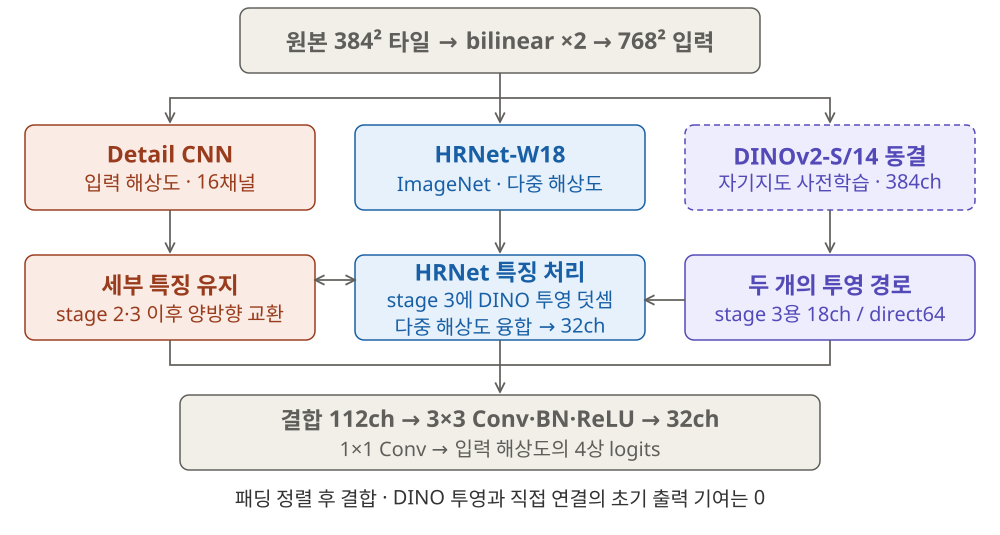
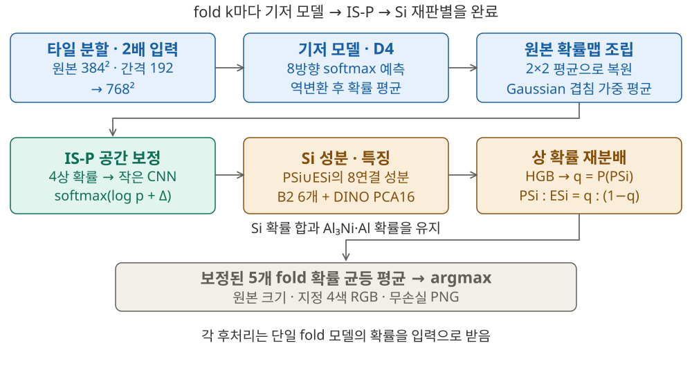

# HiDE-Seg

**High-resolution Detail Exchange Segmentation**

고탄성 알루미늄 합금 광학현미경 영상의 4상 분할 · 2026 KoMaP AI 경진대회


HiDE-Seg는 **고해상도 detail 경로와 HRNet-W18의 양방향 특징 교환**, **동결 DINOv2-S/14 특징의 직접 결합**, **공간·성분 단위 보정**을 연결해 Primary Si, Al₃Ni, Eutectic Si, Al을 분할합니다.

**개발 OOF70 mIoU 79.9828% · 제공 validation20 mIoU 78.5597%**

두 수치는 서로 다른 데이터와 추론 조건의 결과입니다. test 정답 기반 점수는 이 저장소에 보고하지 않습니다.

> **공개 범위:** 코드, 구조도, 집계 실험 결과, 실행 방법을 제공합니다. 대회 데이터셋·원본 영상·GT·예측 마스크·학습 가중치는 포함하지 않습니다. 가중치를 다운로드할 수 있는 공개 Release도 현재 없습니다. 추론에는 별도로 확보한 제출 가중치 또는 재학습한 가중치가 필요합니다.

## 문제와 접근

작고 얇은 ESi를 보존하면서, 비슷한 외관의 상을 정확히 구분하는 것이 핵심 과제였습니다. 분석에서 얻은 질문을 서로 다른 처리 단계로 연결했습니다.

| 질문 | 적용한 접근 | 확인한 범위 |
|---|---|---|
| 얇은 구조의 세부 정보를 유지할 수 있는가? | 입력 해상도의 16채널 detail 경로와 HRNet 특징의 양방향 교환 | 기저 구조 비교 및 다른 구조의 detail 선별 비교 |
| 세부 정보를 상 판별에 연결할 수 있는가? | DINO 마지막 블록을 stage 3와 최종 head에 연결 | 동결 DINO + direct64 비교 |
| 방향에 따른 예측 흔들림을 줄일 수 있는가? | 타일 단위 D4 확률 평균 | 동일 체크포인트의 70장 짝지은 비교 |
| 주변 예측의 공간 관계를 활용할 수 있는가? | 확률맵만 입력하는 IS-P 잔차 보정 | 시드 확인·Gaussian 대조군·5-fold 확장 |
| 이미 검출한 Si의 PSi/ESi 판정을 개선할 수 있는가? | 성분별 확률 요약과 DINO PCA16 특징 | 보정 OOF에서 재학습·재평가 |

각 구성은 개발 실험에서 선택했습니다. 이 표의 관찰만으로 일반적인 우월성이나 모듈별 독립 효과를 주장하지 않습니다. [실험과 판단 근거](docs/EXPERIMENTS.md)

## 모델 구조



- **로컬 입력:** 원본 384×384 크롭을 bilinear 2배 확대해 768×768로 처리합니다. 라벨 확대에는 nearest를 사용합니다.
- **Detail / HRNet:** 16채널 detail 경로와 HRNet의 1/4 해상도 분기가 stage 2·3 이후 정보를 교환합니다.
- **DINOv2:** 자기지도 사전학습 DINOv2-S/14를 동결합니다. 마지막 블록의 384채널 특징을 stage 3용 18채널과 최종 분류부용 64채널로 각각 투영합니다.
- **최종 head:** HRNet 문맥 32 + detail 16 + DINO 64 = 112채널을 결합해 입력 해상도의 4상 logits를 만듭니다.

단계별 gate를 추가한 U-Net 구조가 아니라, HRNet의 고해상도 경로에 DINO 특징을 연결한 구조입니다. 확대 입력은 원본에 없는 정보를 생성하지 않으며, 기존 픽셀의 표현과 처리 해상도를 바꾸는 설정입니다. [구조·학습 상세](docs/MODEL.md)

## 최종 추론 파이프라인



```text
각 fold 모델
  원본 타일 → 2배 입력 → D4 softmax 확률 평균
  → 2×2 평균으로 원본 좌표 복원 → Gaussian 겹침 평균
  → IS-P 공간 보정 → Si 성분 생성 → B2 + PCA16 재판별

test / validation20: 위 과정을 거친 5개 fold 확률의 균등 평균 → argmax
```

IS-P는 RGB 입력을 0으로 두고 기존 4상 확률의 공간 패턴을 학습합니다. Si 재판별기는 예측 PSi·ESi 연결 성분마다 확률 요약 6개와 DINO PCA16을 사용합니다. 재분배 시 PSi+ESi 확률 합과 Al₃Ni·Al 확률을 유지합니다. 마지막 판정은 네 클래스 중 argmax입니다.

## 결과

### 개발 OOF70: 단계별 비교

각 이미지는 해당 이미지를 기저 모델 학습에 사용하지 않은 fold의 예측으로 평가합니다. 후처리의 학습 관계는 [평가 한계](docs/EVALUATION.md)에 별도로 설명합니다.

| 누적 파이프라인 | mIoU (%) | 이전 단계 대비 (%p) |
|---|---:|---:|
| 기저 모델, 단일 방향 | 79.1521 | — |
| + D4 TTA | 79.5327 | +0.3805 |
| + IS-P 공간 보정 | 79.8053 | +0.2726 |
| + B2/PCA16 Si 재판별 | **79.9828** | **+0.1775** |

같은 70장 위에서 순차 비교한 개발 결과입니다. 독립 test 결과나 편향 없는 일반화 추정치로 해석하지 않습니다. [집계 원자료](resources/results.json)

### 제공 validation20: 실제 제출 절차

각 fold에서 보정을 마친 후 5개 확률을 평균하는 제출 절차로 평가했습니다.

| 지표 | 결과 |
|---|---:|
| 이미지별 mIoU, absent=skip | **78.5597%** |
| 이미지별 mIoU, absent=1 | 79.1627% |
| 이미지별 mIoU, absent=0 | 77.9127% |
| Primary Si IoU | 90.8570% |
| Al₃Ni IoU | 72.4728% |
| Eutectic Si IoU | 58.9221% |
| Al IoU | 93.9419% |

클래스별 값은 해당 클래스의 union이 있는 이미지끼리 평균한 값입니다. 위 네 클래스 값을 다시 단순 평균하면 주 지표와 집계 방식이 달라질 수 있습니다. valid20은 초기 개발에 사용한 이력이 있어 완전히 미사용인 holdout으로 표기하지 않습니다.

## 실행

검증 환경은 **Windows / Python 3.11.16 / PyTorch 2.9.1+cu128 / RTX 4090**입니다. GPU 드라이버는 별도로 준비해야 합니다.

```bat
conda env create -f environment.yaml
conda activate phase-seg-submit
python -m pip check
```

제출 가중치를 별도로 보유한 경우 다음 위치에 배치합니다.

```text
src/models/fold0/base.pt
src/models/fold0/refiner.pt
src/models/fold0/reclassifier.joblib
... fold1, fold2, fold3, fold4도 동일
```

```bat
python infer.py --input "D:\data\test.zip" --output "D:\result\hide_seg" --resume
```

입력 ZIP은 `*/images/*_image.png` 구조이며, 최종 결과는 출력 폴더의 `masks/*_mask.png`입니다. `src/manifest.json`으로 코드·제출 가중치·버전을 검사합니다. 원본 데이터와 GT는 다운로드하거나 저장소에 포함하지 않습니다. [데이터·환경·가중치 안내](docs/DATA_AND_REPRODUCIBILITY.md)

새 학습은 [학습 절차](docs/TRAINING.md)를 따릅니다. 기저 모델 학습, fold-local 확률 캐시, IS-P 학습, 보정 OOF, Si 재판별기 학습 순서의 진입점을 제공합니다. 이번 공개용 정리에서 전체 학습을 다시 수행한 것은 아니며, 재학습 결과의 수치 일치를 보장하지 않습니다.

## 재현 검증

2026-10-15에 별도 폴더·새 Conda 환경에서 제출 파이프라인 전체를 실행했습니다.

- test 10장 × 5개 fold 추론 정상 완료
- 50개 fold 확률맵 + 10개 평균 확률맵이 기존 결과와 원소별 완전 일치
- 최종 PNG 10장 변경 픽셀 0개, 파일 SHA256 일치
- 추론 시 네트워크 연결 차단

공개 저장소의 원래 추론 파일은 이 검증본과 같은 바이트를 유지합니다. 공개용 학습 진입점의 점검과 과거 제출 검증은 구분해서 기록합니다. [검증 기록](docs/VERIFICATION.md)

## 저장소 구성

```text
infer.py / train.py / evaluate.py  공개 실행 진입점
src/                              검증한 추론 코드와 모델 구조
training/                         최종 레시피의 독립 학습·캐시 생성
resources/                        fold ID, 설정, 집계 결과, 가중치 해시
assets/                           데이터가 포함되지 않은 SVG 구조도
docs/                             모델·실험·평가·재현 문서
tests/                            합성 입력 기반 수치·지표 검사
scripts/                          공개 범위 검사 및 재학습 모델 패키징
```

## 라이선스와 출처

이 저장소의 자체 코드·문서는 [MIT License](LICENSE)로 제공합니다. HRNet, DINOv2, timm 등 기반 연구와 의존 라이브러리는 각 프로젝트의 라이선스를 따릅니다. 데이터와 사전학습 가중치에 MIT 권한을 부여하는 것은 아닙니다. [외부 출처](THIRD_PARTY_NOTICES.md)

개발·코드 작성·문서 정리에 AI 코딩 도구의 도움을 받았으며, 실험 설정 선택과 실행 결과 확인을 거쳐 제출 파이프라인을 확정했습니다.
